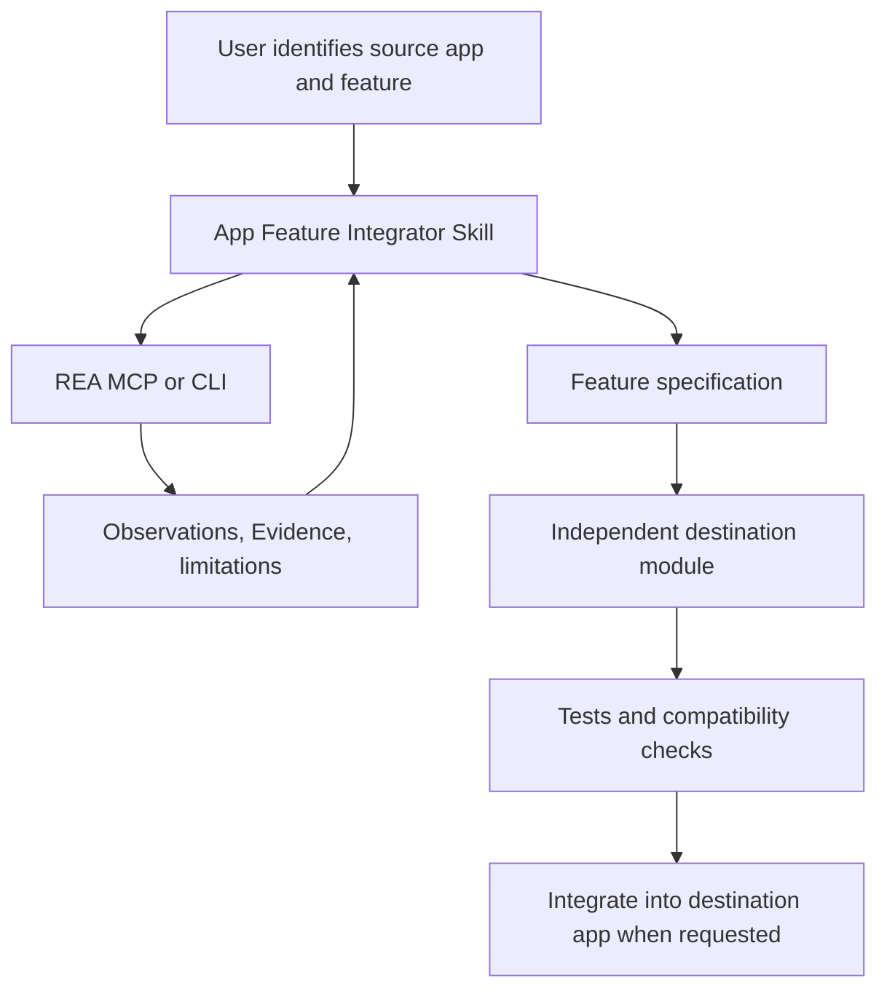

# Integrating app features with AI and REA

This guide describes the recommended hybrid architecture for studying a feature in an application and implementing an equivalent feature in a separate project.

## Recommended architecture



### Responsibilities

| Part | Responsibility | Should it ship in the user's app? |
| --- | --- | --- |
| REA MCP/CLI engine | Inspect authorized binaries, packages, source artifacts, or runtime behavior | Normally no; it is a development-time tool |
| `reverse-engineer-anything` Skill | Guide REA investigations and evidence handling | No; it is agent guidance |
| `app-feature-integrator` Skill | Coordinate investigation, specification, implementation, and tests | No; it is agent guidance |
| Feature module | Implement the new behavior using the destination project's architecture | Yes |
| Destination UI | Expose the module to the user if UI integration is requested | Yes, when in scope |

**Key distinction:** the Skill does not perform reverse engineering by itself. It guides the coding agent, which calls REA MCP/CLI. REA returns evidence; the agent uses that evidence to specify, implement, and test a separate module.

## Setup

### 1. Connect REA to the agent

From a project environment with a supported Node.js version and npm:

```bash
npx rea-agents@latest setup
```

Review the proposed configuration changes and approve them. Restart or reconnect the agent afterward. Follow [installation and setup](./installation.md) for provider requirements and troubleshooting.

### 2. Install the integration Skill

Once this Skill is available on the repository's default branch, install it into the destination project:

```bash
npx skills add khanhtran0393/rea --skill app-feature-integrator
```

Installing a Skill adds instructions; it does **not** register the REA MCP server or install native analysis engines. Those are separate setup steps.

### 3. Ask for a bounded feature

Example prompt:

> Use REA to investigate the authorized local application at `D:/apps/source-app`, focusing only on its subtitle export feature. Write a feature specification, implement an independently tested equivalent module in this repository, and report evidence, unknowns, and tests. Do not copy source code or assets from the original application.

Replace the example path with the real target and make sure the destination project is the active workspace.

## Implementation workflow

1. **Identify:** resolve the source target, feature, destination project, and acceptance criteria.
2. **Inspect:** use the REA tools that are actually available in the current session. Begin with static analysis; use runtime observation only when required and authorized.
3. **Specify:** record behavior, inputs/outputs, errors, dependencies, evidence, confidence, and unknowns in a feature spec.
4. **Implement:** create an independent module following the destination repository's conventions. Prefer official APIs or SDKs when appropriate.
5. **Verify:** add tests for normal cases, edge cases, failures, cancellation, and compatibility. Run the repository's relevant checks.
6. **Integrate:** wire the module into UI or production pipelines only when requested.
7. **Report:** list changed files, evidence, limitations, required configuration, and actual test outcomes.

## Module design guidance

A feature module might live at `modules/<feature-slug>/`, with its specification at `specs/<feature-slug>.md`, but do not force these directories onto a repository that has a different established structure.

Keep a narrow public interface and isolate provider/API calls from business logic. Use explicit configuration, typed contracts, bounded timeouts, cancellation, error handling, and tests. Keep secrets out of logs and reports.

Do not assume `rea-agents` is a stable importable application library. REA documents CLI and MCP usage; use those interfaces unless a supported public library API has been independently verified. Do not bundle REA into a production application unless in-app reverse-engineering is itself an explicit product requirement.

## Evidence and responsible use

- Work only on applications, accounts, and data you own or are authorized to inspect.
- Prefer documented APIs and SDKs for integration.
- Reimplement behavior independently; do not copy proprietary source, credentials, private assets, or secrets.
- Do not bypass licensing, authentication, DRM, or access controls.
- Separate observed facts from hypotheses. A decompiler's pseudocode or static relationship is not proof of runtime behavior.
- Report unknown behavior and analysis coverage rather than promising a perfect reconstruction.

See the [REA Skill](https://github.com/morluto/rea/blob/main/.agents/skills/reverse-engineer-anything/SKILL.md) and [CLI guide](./cli.md) for investigation details.
